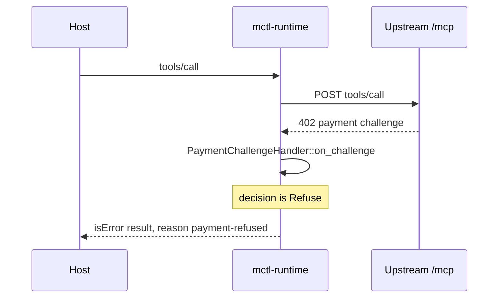

# Spike #746: is a portable agent-side runtime worth building, and in Rust?

Status: **code phase.** Run id: `unmeasured (pending bench run)`. Head SHA: `unmeasured (pending bench run)`.
The shepherd fills both, the measurements table and G5/G6 after the CI `bench` job has run on the final code head
(see `docs/spikes/746/measurements/README.md`). This report proposes a decision; the verdict stays with the #746 owner.

The possible decision tokens are `NO_RUNTIME`, `THIN_ADAPTER`, `PORTABLE_RUNTIME_RUST` and `PORTABLE_RUNTIME_OTHER`.
The Decision section carries exactly one.

## Environment

| Item | Value |
|---|---|
| Rust crate | `experiments/portable-runtime-rs/` (std-only, `rust-toolchain.toml` pins 1.85.0, `Cargo.lock` holds only the package) |
| Python baseline | `experiments/portable-runtime-rs/baseline/thin_adapter.py` on `mcp==1.29.0` |
| Runners | ubuntu-latest and macos-14 (`bench` job); cross targets in the `cross-build` job |
| uv / Python | uv 0.11.11, Python 3.12 (setup-uv pinned as in `spike-707-bench.yml`) |
| Runner details | `unmeasured (pending bench run)`; the environment block is in `measurements/<os>.md` |

## 1. Current-state map and friction list

What exists today (slices 1 and 2, tests T2 to T10 in `cargo test`):

- `mctl-runtime proxy`: newline-delimited JSON-RPC on stdio in front of one Streamable HTTP `/mcp` upstream.
  `tools/list` is filtered to an allowlist; a non-allowlisted call is refused with `not-eligible` and makes no
  upstream request (T2, T3); upstream refusals pass through unchanged (T4); failures map to stable reason codes (T5, T6);
  every call is correlated with an invocation id (T8).
- `mctl-runtime init`: prints host config that references the credential by env var name or file path (T9).
- `mctl-runtime doctor`: credential, allowlist and upstream round-trip checks.
- Credentials come from a `0600` token file or `MCTL_TOKEN`, are never in argv, config or logs (T7) and are refused if the
  file mode is too open (T10).

Friction a local process could address (from the issue and the slice work): a host that can only start stdio servers cannot
talk to a remote Streamable HTTP `/mcp` directly; each host wants its own config snippet; the token has to reach the host
without being pasted into a config file; and per-call correlation is not available from the host side.

## 2. Duplicate check

The proposal behind this slice lists these as overlapping work: #242, #717, mctl-telegram#784, mctlhq/.github#34 / #652 and
mctlhq/.github#173 / mctl-api#616. They were not re-read in the offline implementer environment; the reviewer should
confirm that none already delivers a host-side bridge or a host config generator before the verdict is recorded.
This is an open item, not a finding.

## 3. Measurements

All cells stay literal until the shepherd commits the CI artifact. Source: `measurements/ubuntu-latest.md`,
`measurements/macos-14.md`. Rust size, build, dependency and startup numbers are **http-only, TLS not included**.

| Metric | Rust proxy (ubuntu-latest) | Python baseline (ubuntu-latest) | Rust proxy (macos-14) | Python baseline (macos-14) |
|---|---|---|---|---|
| Build time | unmeasured (pending bench run) | unmeasured (pending bench run) | unmeasured (pending bench run) | unmeasured (pending bench run) |
| Binary / package size | unmeasured (pending bench run) | unmeasured (pending bench run) | unmeasured (pending bench run) | unmeasured (pending bench run) |
| Dependency count (`ldd` / `otool -L` / distributions) | unmeasured (pending bench run) | unmeasured (pending bench run) | unmeasured (pending bench run) | unmeasured (pending bench run) |
| Cold start to ready, median / p95 (N=20) | unmeasured (pending bench run) | unmeasured (pending bench run) | unmeasured (pending bench run) | unmeasured (pending bench run) |
| Cold start through `uv run` | not applicable | unmeasured (pending bench run) | not applicable | unmeasured (pending bench run) |
| Idle RSS | unmeasured (pending bench run) | unmeasured (pending bench run) | unmeasured (pending bench run) | unmeasured (pending bench run) |
| RSS during a call | unmeasured (pending bench run) | unmeasured (pending bench run) | unmeasured (pending bench run) | unmeasured (pending bench run) |
| First-call overhead vs direct HTTP | unmeasured (pending bench run) | unmeasured (pending bench run) | unmeasured (pending bench run) | unmeasured (pending bench run) |
| Steady-state overhead vs direct HTTP, median / p95 (N=100) | unmeasured (pending bench run) | unmeasured (pending bench run) | unmeasured (pending bench run) | unmeasured (pending bench run) |
| Live run against `api.mctl.ai` | unmeasured (not run in this slice) | unmeasured (not run in this slice) | unmeasured (not run in this slice) | unmeasured (not run in this slice) |

Parity (T11): the Rust proxy and the baseline return semantically equal `result` objects for `tools/list` and for calls to
`mctl_whoami`, `deny_tool`, `approval_tool`, `secret_tool` and an unknown name. Byte differences are a finding, recorded in
`measurements/parity-bytes.md` (`unmeasured (pending bench run)`). The Python SDK re-serializes tool schemas through pydantic,
so key order and number text such as `1.50` can differ from the upstream bytes the Rust proxy preserves (T2). The baseline's
error mapping is minimal (any upstream failure becomes `provider-unavailable`); timeout and 401 parity are not claimed.

## 4. TLS limit

The crate is std-only and speaks plain `http://`; an `https://` upstream, including the real `api.mctl.ai/mcp`, is refused.
Adding `rustls` would need checksummed registry entries in `Cargo.lock` that the offline implementer cannot produce, would
arrive in a commit that skipped review, and would end the one-entry lock that `cargo audit` relies on. So the limit is
documented and every affected number is labelled `http-only, TLS not included`.

Consequences: the Rust size, build-time, dependency-count and startup numbers are lower bounds. A TLS-capable artifact is
unmeasured, and no estimate is made here beyond that it will be larger and add dependencies. The Python baseline already
carries TLS through `httpx`, so the size comparison favours Rust more than a like-for-like build would. If the verdict leans
toward a portable runtime, measuring a TLS variant is the first follow-up.

## 5. Matrix

| # | Dimension | Rust proxy | Python thin adapter | Evidence |
|---|---|---|---|---|
| 1 | Install artifact count | One binary | A script plus an interpreter and the `mcp` closure | `measurements/` dependency counts (unmeasured (pending bench run)) |
| 2 | Cold start | unmeasured (pending bench run) | unmeasured (pending bench run) | `measurements/` ready records |
| 3 | Steady RSS | unmeasured (pending bench run) | unmeasured (pending bench run) | `measurements/` rss records |
| 4 | Binary / package size | unmeasured (pending bench run), http-only, TLS not included | unmeasured (pending bench run) | `measurements/` size records |
| 5 | macOS arm64 | Native build on macos-14 in `cargo` and `bench` | Runs on macos-14 in `bench` | `measurements/macos-14.md`, `cross-build.json` (unmeasured (pending bench run)) |
| 6 | Linux amd64 / arm64 | amd64 musl runs `--version`; arm64 musl is built, run only if an arm runner exists | Interpreter-dependent, architecture-neutral script | `measurements/cross-build.json` (unmeasured (pending bench run)) |
| 7 | Windows feasibility | Compile-only attempt; Unix-only APIs (`credential.rs` file-mode checks) may fail | Not attempted in this slice | `measurements/cross-build.json` (unmeasured (pending bench run)) |
| 8 | Cross-compilation / release complexity | rust-lld musl links, no Docker or Zig; one target per build | None beyond packaging an interpreter | `measurements/cross-build.json` (unmeasured (pending bench run)) |
| 9 | TLS / OAuth / MCP ecosystem maturity | Hand-rolled MCP subset and HTTP/1.1, no TLS, no OAuth; the official Rust SDK was not used | Official `mcp` SDK, TLS through `httpx`, OAuth helpers available | README of the crate, T11 |
| 10 | Child-process credential exposure | Token from file or env, never in argv; `spawn.rs` strips it from children | Same sources; the interpreter's environment and memory hold it | T6, T7, T10 |
| 11 | Embedding / library reuse with current MCTL | None: MCTL is Python, the crate is a separate binary | Reusable from the Python code base in principle | T11 |
| 12 | Sandbox / WASM potential | std-only code is a candidate for a wasm target; not attempted | Not applicable | Q8 below |
| 13 | Operator / debug UX | `init` and `doctor`, stderr correlation lines | The same flags; no `init` or `doctor` | T8, T9 |
| 14 | Implementation / maintenance complexity | Hand-rolled JSON, SHA-256, UUID and HTTP; adds Rust to the maintenance surface | About 150 lines on an SDK that is already a pinned dependency | T11, `baseline/thin_adapter.py` |

## 6. Questions

- **Q1. Which real MCTL flows need an agent-side process rather than direct remote MCP?** Only hosts that start stdio servers
  and cannot speak Streamable HTTP with a bearer token. Hosts with native remote MCP do not need one.
- **Q2. Which are already solved by #242, host skills or MCP config?** Hosts with remote MCP config are solved by config. The
  remaining gap is stdio-only hosts. Not re-verified against #242 offline.
- **Q3. Is host bootstrap or config generation enough?** For most hosts, yes: `init` output (T9) is the part that removes
  friction. The bridge itself is the smaller part of the value.
- **Q4. Does local result shaping or caching give token or latency value without data-custody problems?** Not shown.
  Neither subject shapes or caches results, and caching tool results locally creates a custody question. No evidence either way.
- **Q5. Does a runtime improve credential isolation, or only move credentials into another process?** It moves them. See J3.
- **Q6. Should runtime policy be preflight and UX only, with server policy authoritative?** Yes. The allowlist only narrows
  what the server offers (T2, T3) and upstream refusals pass through unchanged (T4). The runtime holds no authority of its own.
- **Q7. Is x402 a natural future adapter at this boundary?** Plausibly, because a 402 challenge arrives on the upstream
  response path. See J6. Nothing is built.
- **Q8. Would WASM help MCTL in a concrete scenario?** No concrete scenario was found. The std-only crate does not rule it out.
- **Q9. If GO, what belongs in v1 and what stays server-side?** Not applicable to the proposed decision.
- **Q10. If GO, which repository and owner?** Not applicable to the proposed decision.

## 7. J3: credential analysis

Evidence: T6 (absent or rejected token, no request when absent), T7 (the token is not in argv, child environment, config or
logs), T10 (token files with group or other bits are refused). The runtime reads the token from `MCTL_RUNTIME_TOKEN_FILE`
or `MCTL_TOKEN`, redacts it in `Debug`, and strips both variables from child processes.

What is **not** isolated:

- the runtime process's own environment and memory;
- the host config, which names the env var or file that holds the token;
- a same-user reader of the token file;
- `MCTL_TOKEN` inherited from the host, which the host's own environment already exposes.

So the runtime is not worse than the direct path, and it is not better in any way that matters against a same-user attacker.
It adds a process that holds the token.

## 8. J6: x402 note



A sketch of the only handler this spike would allow. It is documentation, not crate code, and it never pays:

```rust
pub enum PaymentDecision {
    Refuse,
}

pub trait PaymentChallengeHandler {
    fn on_challenge(&self, challenge: &str) -> PaymentDecision;
}

pub struct RefuseAll;

impl PaymentChallengeHandler for RefuseAll {
    fn on_challenge(&self, _challenge: &str) -> PaymentDecision {
        PaymentDecision::Refuse
    }
}
```

No payment code is added to the crate. Paying would give the runtime spending authority, which conflicts with G3.

## 9. AI Gateway and `createAI` boundary

Benchmarked against the Cloudflare AI Gateway / `createAI` shape: model routing, fallback, BYOK and provider abstraction stay
outside `mctl-runtime`. The runtime is a tool-call boundary, not a model gateway. Any product finding from this comparison is
routed to mctlhq/.github#184 G4 and is not acted on here.

## 10. Transport note

Cloudflare retired `/sse` for its product MCP servers. #746 targets local stdio plus upstream Streamable HTTP `/mcp`, and the
crate does not implement the legacy SSE transport. There is no SSE work in this spike.

## GO checklist

Marks: met, not met or unproven. Each line cites a measurement file or a test id.

- **G1** at least two cross-host jobs that direct MCP, config or skills do not solve cleanly: **unproven**, at most one is shown (stdio-only hosts); see Q1, Q2 and T9.
- **G2** one artifact materially reduces friction: **unproven**; `init` plus a single binary or script helps, but the same `init` output works for either subject (T9, T11).
- **G3** no new local authorization or business-logic authority: **met**; policy is preflight only and the server stays authoritative (T2, T3, T4).
- **G4** credential handling no worse than the direct path, with a credible storage or handoff model: **met**, with the limits in J3 (T6, T7, T10).
- **G5** proxy overhead small enough for interactive use: **unproven**; `measurements/ubuntu-latest.md` and `measurements/macos-14.md` are pending the bench run.
- **G6** packaging and update story simple enough to justify another component: **unproven**; a TLS-capable artifact is unmeasured, see `measurements/cross-build.json` and the TLS limit (pending the bench run).
- **G7** at least two hosts or environments can reuse the boundary: **unproven**; only the fixture host is exercised (T9), see `measurements/` host notes.
- **Rust clause** a material packaging, runtime or sandbox advantage that outweighs adding Rust: **not met on current evidence**; the baseline passes the same parity test (T11) and size and startup are pending in `measurements/`.

## Decision

Proposed: `THIN_ADAPTER`.

Basis: G1 and G7 are unproven, so a portable runtime is not supported. Bootstrap and config generation (T9) carry the value
that is shown, and the Python baseline matches the Rust proxy on the compared behaviour (T11). G5 and G6 are re-checked by the
shepherd after the bench run. This is a proposal; the verdict stays with the #746 owner.

## Recommendations and follow-ups

Not applicable (decision is not GO).
